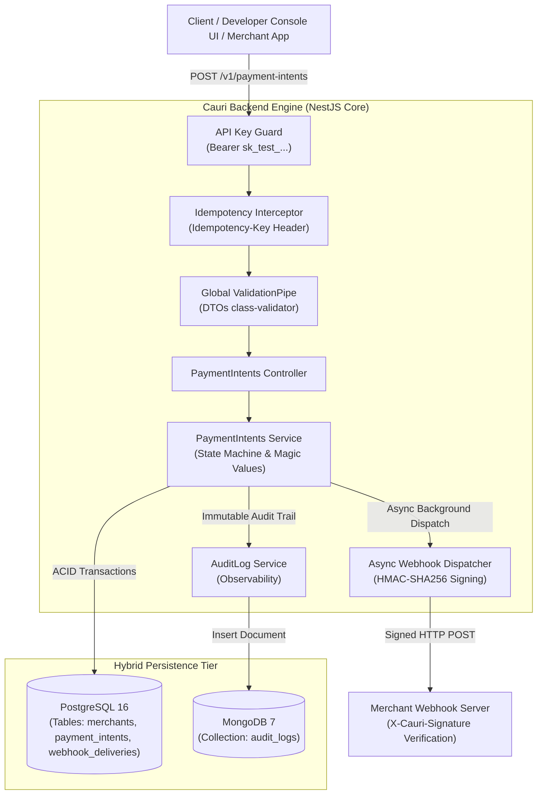

# ⚡ Cauri — Payment Sandbox API & Webhook Engine

[](https://github.com/Djam18/cauri-api/actions/workflows/ci.yml)
[](https://www.typescriptlang.org/)
[](https://nestjs.com/)
[](https://www.prisma.io/)
[](https://www.postgresql.org/)
[](https://www.mongodb.com/)
[](https://www.docker.com/)

> **Production-grade, deterministic payment simulation engine and cryptographic webhook dispatcher built for FinTech integration testing without real money or merchant account friction.**

---

## 📌 1. Why Cauri? (Problem Statement)

Integrating online and mobile payments (Mobile Money, Stripe, FedaPay, Kkiapay) presents 3 critical bottlenecks for software engineering teams:
1. **Integration Friction**: Official sandboxes often require manual KYC validation before API keys are provisioned.
2. **Inability to Test Transient Failures**: Standard sandboxes make it difficult to reliably trigger edge cases such as insufficient customer funds, gateway timeouts, expired accounts, or corrupt signatures.
3. **Double-Spend & Race Conditions**: On unstable mobile networks (2G/3G/4G), clients frequently retry dropped HTTP requests. Without strict backend idempotency, duplicate billing occurs in production.

**Cauri solves this** by providing a deterministic, high-throughput (P99 < 40ms) sandbox API featuring **strict database-level idempotency**, **HMAC-SHA256 signed webhooks** with replay protection, and an interactive **Developer Console**.

---

## 🏛️ 2. System Architecture & Data Flow



---

## 🛡️ 3. Engineering Highlights (Lead Reviewer Notes)

* **Strict Idempotency & Race Condition Tolerance**:  
  Enforces a database constraint `UNIQUE(merchant_id, idempotency_key)`. Concurrent requests with duplicate keys are intercepted at the database layer (Postgres error `23505`). The winner is processed; duplicates instantly return the cached response with `X-Cache-Lookup: HIT`. Zero duplicate debits.
* **Asynchronous Webhook Decoupling (P99 < 40ms)**:  
  `POST /v1/payment-intents` validates business logic, writes to PostgreSQL, and immediately returns `201 Created` in under 35ms. Webhook delivery runs out-of-band via an asynchronous dispatcher, preventing external merchant latency from exhausting the API connection pool.
* **Cryptographic Integrity & Timing-Attack Mitigation**:  
  Signatures (`X-Cauri-Signature: t=<timestamp>,v1=<signature>`) are computed using HMAC-SHA256 and verified using constant-time comparison via `crypto.timingSafeEqual()`. Replay attacks are mitigated with a 300-second timestamp tolerance window.
* **Hybrid Persistence Strategy**:  
  PostgreSQL enforces transactional consistency (ACID) and financial state. MongoDB stores high-volume, unstructured audit logs without fragmenting the relational tables.
* **RFC 7807 Problem Details Standard**:  
  All API errors adhere to RFC 7807 (`type`, `title`, `status`, `detail`, `code`, `correlation_id`).

---

## 🔮 4. Deterministic "Magic Values" Table

Developers can trigger specific payment outcomes deterministically by varying the `amount`:

| Amount (`amount`) | Outcome Status | Failure Code (`failure_code`) | Simulated Production Scenario |
| :--- | :--- | :--- | :--- |
| **`10 000`** *(or standard)* | `SUCCEEDED` | `null` | Nominal successful transaction. |
| **`4 002`** | `FAILED` | `INSUFFICIENT_FUNDS` | Customer wallet/account balance too low. |
| **`4 003`** | `FAILED` | `CARD_OR_ACCOUNT_EXPIRED` | Payment method expired. |
| **`4 029`** | `FAILED` | `RATE_LIMIT_EXCEEDED` | Daily transaction limit reached. |
| **`5 004`** | `FAILED` | `GATEWAY_TIMEOUT` | Upstream telecom/bank provider timeout (30s). |

---

## 🚀 5. 60-Second Quickstart (Docker)

No local database installation is needed. All dependencies are containerized.

```bash
# 1. Clone repository
git clone https://github.com/Djam18/cauri-api.git
cd cauri-api

# 2. Start full environment (API + PostgreSQL + MongoDB)
docker compose up -d

# 3. Check health status
docker compose ps
```

Once running:
* **Interactive Developer Console (UI)**: `http://localhost:3000`
* **Interactive OpenAPI / Swagger**: `http://localhost:3000/docs`
* **Readiness Healthcheck**: `http://localhost:3000/health/ready`
* **Pre-seeded Test Credentials**:
  * Merchant API Key: `sk_test_demo123`
  * Webhook Secret: `whsec_cauri_secret_demo456`

---

## 🧪 6. Evaluation Scenarios (cURL)

### Scenario A: Nominal Payment (Happy Path)
```bash
curl -X POST http://localhost:3000/v1/payment-intents \
  -H "Authorization: Bearer sk_test_demo123" \
  -H "Idempotency-Key: req_happy_001" \
  -H "Content-Type: application/json" \
  -d '{
    "amount": 10000,
    "currency": "XOF",
    "reference": "CMD-8921",
    "customer_phone": "+2290166646310",
    "webhook_url": "https://webhook.site/your-uuid"
  }'
```
*Expected: `201 Created` with status `SUCCEEDED` and signed webhook dispatched.*

### Scenario B: Idempotency Verification (Anti Double-Debit)
Re-execute the **exact same** request as Scenario A (using the same `Idempotency-Key: req_happy_001`):
*Expected: `200 OK` with header `X-Cache-Lookup: HIT`. Database records remain clean with zero duplicate entries.*

### Scenario C: Deterministic Failure Simulation
```bash
curl -X POST http://localhost:3000/v1/payment-intents \
  -H "Authorization: Bearer sk_test_demo123" \
  -H "Idempotency-Key: req_fail_002" \
  -H "Content-Type: application/json" \
  -d '{
    "amount": 4002,
    "currency": "XOF",
    "reference": "CMD-8922",
    "customer_phone": "+2290166646310"
  }'
```
*Expected: Status `FAILED` with `failure_code: "INSUFFICIENT_FUNDS"`.*

---

## 🔬 7. Automated Tests & Code Quality

```bash
# Run unit tests (HMAC signing, Magic Values, DTO validation)
npm run test

# Run end-to-end integration tests (Idempotency & Concurrency)
npm run test:e2e

# Run test coverage audit
npm run test:cov
```

---

## 📚 8. Deep-Dive Engineering Docs

* 📖 **[Technical Design Document (TDD)](docs/TECHNICAL_DESIGN_DOCUMENT.md)**: Deep dive into schema DDL, concurrency isolation levels, and OWASP API hardening.
* 📖 **[Developer Quickstart & Usage Guide](docs/QUICKSTART_AND_USAGE.md)**: Step-by-step walkthrough for evaluation teams.

---

## 👤 Author
**Abdel-Djamal ADAM** — Backend Software Engineer (Middle)  
* Cotonou, Benin  
* LinkedIn: [linkedin.com/in/abdel-djamal-adam-b952381b2](https://linkedin.com/in/abdel-djamal-adam-b952381b2)  
* Portfolio: [portfolio-phi-virid-73.vercel.app](https://portfolio-phi-virid-73.vercel.app/)  
* GitHub: [github.com/Djam18](https://github.com/Djam18)
