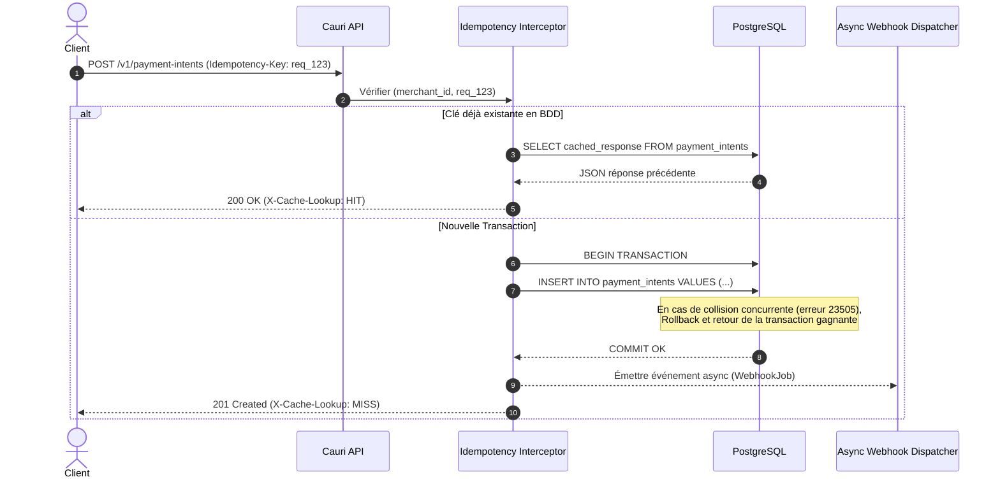

# Technical Design Document (TDD) — Enterprise Grade
# Projet : Cauri — API Sandbox de Paiement & Moteur de Webhooks

| Métadonnée | Valeur |
| :--- | :--- |
| **Auteur** | Abdel-Djamal ADAM — Développeur Backend |
| **Destinataires** | Lead Développeurs Backend / Architectes Logiciels / SRE |
| **Version** | 1.1.0 (Production & Enterprise Hardened) |
| **Statut** | Spécification Technique Validée pour Implémentation |
| **Stack Cible** | NestJS v10+, TypeScript 5+, PostgreSQL 16, MongoDB 7, Redis 7 (Cache/Queue), Docker |

---

## 1. Contexte, Scope & Proposition de Valeur

### 1.1 Problématique Métier FinTech
Dans les architectures de paiement (Mobile Money, passerelles comme FedaPay, Kkiapay, Stripe) :
1. **Friction d'intégration & délais KYC** : Les bacs à sable officiels nécessitent souvent des comptes validés manuellement.
2. **Impossibilité de forcer des pannes critiques** : Tester la tolérance d'une application cliente face à des erreurs réseau (`GATEWAY_TIMEOUT`), des soldes insuffisants ou des signatures corrompues est complexe.
3. **Risque de double débit (Race conditions)** : En conditions réseau dégradées (2G/3G instable), les clients réémettent des requêtes identiques. Sans gestion stricte de l'idempotence, le risque de double facturation en base de données est critique.

### 1.2 La Réponse Cauri
Un microservice déterministe, hautement disponible et sécurisé garantissant :
* **Latence p99 < 50ms** sur la création d'intention de paiement.
* **Idempotence stricte** au niveau applicatif et base de données.
* **Découplage asynchrone** de l'émission des webhooks (l'appel client ne bloque jamais sur l'envoi du webhook).
* **Sécurité cryptographique et durcissement OWASP** de niveau bancaire.

---

## 2. Les Piliers d'Excellence Backend (Au-delà du simple CRUD)

Un backend de qualité industrielle ne se résume pas à écrire des routes. Il est évalué par les Lead Développeurs sur **5 dimensions fondamentales** :

```text
┌──────────────────────────────────────────────────────────────────────────────┐
│                    LES 5 PILIERS D'UN BACKEND DE NIVEAU LEAD                 │
├──────────────────────────────────────────────────────────────────────────────┤
│ 1. SÉCURITÉ & DURCISSEMENT       │ Cryptographie à temps constant, OWASP,   │
│                                  │ Anti-rejeu, Masquage PII, Rate Limiting   │
├──────────────────────────────────┼───────────────────────────────────────────┤
│ 2. PERFORMANCE & SCALABILITÉ     │ Découplage asynchrone, Pool BDD, Index,  │
│                                  │ Caching chaud des clés, P99 < 50ms        │
├──────────────────────────────────┼───────────────────────────────────────────┤
│ 3. RÉSILIENCE & FAULT TOLERANCE  │ Idempotence, Exponential Backoff + Jitter,│
│                                  │ Circuit Breaker, Graceful Shutdown        │
├──────────────────────────────────┼───────────────────────────────────────────┤
│ 4. OBSERVABILITÉ & SRE           │ Correlation ID continu, Healthchecks      │
│                                  │ (/live & /ready), Structured JSON Logs    │
├──────────────────────────────────┼───────────────────────────────────────────┤
│ 5. CONTRAT LOGICIEL & CRAFT      │ Clean Architecture, RFC 7807, DTOs stricts│
│                                  │ Tests unitaires & E2E reproductibles      │
└──────────────────────────────────────────────────────────────────────────────┘
```

---

## 3. Sécurité & Hardening (Défense en Profondeur)

### 3.1 Protection Cryptographique & Attaques par Timing
* **Calcul de Signature HMAC-SHA256** :
  $$\text{Payload Signé} = \text{timestamp} + "." + \text{raw\_body}$$
  $$\text{Signature} = \text{HMAC-SHA256}(\text{Payload Signé}, \text{merchant\_secret})$$
* **Comparaison à Temps Constant** :
  Toute vérification de signature dans les tests et l'inspecteur utilise impérativement `crypto.timingSafeEqual(bufferA, bufferB)`. L'utilisation d'un simple opérateur `===` est proscrite car elle ouvre la porte aux attaques temporelles par canal auxiliaire (*timing side-channel attacks*).
* **Attaques par Rejeu (Replay Attacks)** :
  L'en-tête de webhook `X-Cauri-Signature: t=1731154000,v1=...` transmet le timestamp en secondes. Si $|t_{\text{courant}} - t_{\text{requête}}| > 300\text{ s}$ (5 minutes), la notification est invalidée.

### 3.2 OWASP API Security Top 10 appliquée à Cauri
1. **Broken Object Level Authorization (BOLA)** : Chaque ressource (`PaymentIntent`) est impérativement scopée par le `merchant_id` extrait du token. Impossible pour le Marchand A de lire ou manipuler les transactions du Marchand B, même en devinant l'identifiant UUID (`WHERE id = :id AND merchant_id = :merchantId`).
2. **Mass Assignment & Injection de Données** : Le `ValidationPipe` global active `{ whitelist: true, forbidNonWhitelisted: true }`. Tout attribut JSON non déclaré dans le DTO TypeScript provoque une erreur `400 Bad Request` immédiate.
3. **Déni de Service & Rate Limiting** : Implémentation du module `@nestjs/throttler` avec fenêtre glissante :
   * Limite : **60 requêtes / minute** par clé API marchand (`sk_test_...`).
   * En cas de dépassement : Réponse `429 Too Many Requests` avec en-têtes RFC 6585 (`Retry-After`, `X-RateLimit-Limit`, `X-RateLimit-Remaining`).
4. **Masquage des Données Sensibles (PII)** :
   * Les numéros de téléphone sont anonymisés dans les logs applicatifs (`+229 01 ** ** 10`).
   * Zéro stockage ou transit de données de carte bancaire (conforme PCI-DSS).
5. **En-têtes de Sécurité HTTP** : Intégration de `helmet` (protection XSS, `X-Content-Type-Options: nosniff`, `Strict-Transport-Security`, interdiction de framing `X-Frame-Options: DENY`).

---

## 4. Performance & Scalabilité

### 4.1 Découplage Asynchrone de l'Émission des Webhooks
Un anti-pattern classique en backend de paiement consiste à contacter l'URL du webhook marchand avant de répondre au client final. Si le serveur marchand est lent (ex: 4 secondes de latence), l'API s'effondre sous la charge par épuisement des sockets HTTP.

**Solution retenue dans Cauri** :
* Le endpoint `POST /v1/payment-intents` effectue uniquement l'évaluation métier et l'insertion PostgreSQL (durée : **15 à 30 ms**), puis renvoie immédiatement la réponse `201 Created` au client.
* L'émission du webhook est déléguée de façon asynchrone à un service d'arrière-plan (*EventEmitter* interne ou job queue Redis/BullMQ).

### 4.2 Optimisation BDD & Dimensionnement du Pool de Connexions
* **PostgreSQL Connection Pool** :
  * Taille configurée : `min: 5`, `max: 20` par instance NestJS.
  * Timeout d'inactivité : `idleTimeoutMillis: 30000`.
  * Timeout d'acquisition : `connectionTimeoutMillis: 2000` (évite que les requêtes restent bloquées indéfiniment si la BDD est saturée).
* **Indexation B-Tree Optimale** :
  ```sql
  -- Index unique garantissant l'unicité et accélérant le lookup d'idempotence O(log N)
  CREATE UNIQUE INDEX uq_merchant_idempotency ON payment_intents (merchant_id, idempotency_key);
  
  -- Index composite pour la pagination rapide de l'historique marchand
  CREATE INDEX idx_payment_intents_merchant_created ON payment_intents (merchant_id, created_at DESC);
  ```
* **Mise en Cache des Clés Marchandes (Hot Cache)** :
  Les informations du marchand (`id`, `webhook_secret`, statut) sont mises en cache en mémoire ou sous Redis avec un TTL de 5 minutes pour éviter d'exécuter un `SELECT * FROM merchants` à chaque requête d'API.

---

## 5. Résilience & Tolérance aux Pannes

### 5.1 Stratégie d'Idempotence Robuste (Gestion des Race Conditions)



### 5.2 Retry Strategy avec Exponential Backoff + Full Jitter
Si le serveur du marchand répond en erreur (HTTP 5xx) ou par un timeout lors de la réception du webhook :
* Cauri ne renonce pas immédiatement et n'inonde pas le serveur marchand d'un coup (*thundering herd problem*).
* **Algorithme d'attente exponentielle avec aléa (Full Jitter)** :
  $$t_{\text{wait}} = \text{random}(0, \min(t_{\text{max}}, t_{\text{base}} \times 2^{\text{attempt}}))$$
* Plan de rejeux : 5 tentatives (Immédiat, +10s, +1min, +15min, +1h) avant passage en statut `PERMANENTLY_FAILED`.

### 5.3 Circuit Breaker & Timeout Explicite
* Tout appel HTTP sortant vers une URL marchande est soumis à un timeout strict de **5 000 ms**.
* Si un marchand a un taux d'échec de 100 % sur 20 requêtes consécutives, le disjoncteur (*Circuit Breaker*) s'ouvre pour protéger les ressources réseau de l'API.

### 5.4 Arrêt Propre (Graceful Shutdown)
À la réception d'un signal `SIGTERM` ou `SIGINT` (ex: redémarrage Docker / Kubernetes) :
1. NestJS cesse d'accepter de nouvelles requêtes HTTP (`server.close()`).
2. Les requêtes en cours disposent d'un délai de grâce de 10 secondes pour se terminer proprement.
3. Les pools de connexions PostgreSQL et MongoDB sont drainés et fermés sans coupure brutale.

---

## 6. Observabilité, Traçabilité & SRE

### 6.1 Traçabilité Distribuée (Correlation ID)
* Chaque requête entrante reçoit un `X-Request-Id` (UUID v4) via middleware s'il n'est pas fourni par le client.
* Ce `correlation_id` est :
  1. Injecté dans l'en-tête de réponse HTTP.
  2. Préfixé sur chaque ligne de log applicatif.
  3. Stocké dans la collection `audit_logs` MongoDB.
  4. Transmis dans l'en-tête du webhook envoyé au marchand (`X-Correlation-Id`).

### 6.2 Formatage Structuré des Logs (Zero `console.log`)
Tous les logs sont émis au format JSON standardisé sur `stdout` (idéal pour Datadog, Grafana Loki, CloudWatch) :
```json
{
  "level": "info",
  "timestamp": "2026-11-10T10:15:30.102Z",
  "correlation_id": "req_8921-ca41-49fa",
  "merchant_id": "mch_0182ab",
  "method": "POST",
  "path": "/v1/payment-intents",
  "status_code": 201,
  "duration_ms": 23.4,
  "message": "PaymentIntent successfully created"
}
```

### 6.3 Healthchecks & Sondes Kubernetes / Docker
Intégration du module `@nestjs/terminus` :
* **Liveness Probe** (`GET /health/live`) : Vérifie si le process Node.js répond (retourne `200 OK`).
* **Readiness Probe** (`GET /health/ready`) : Effectue un `SELECT 1` sur PostgreSQL et un `ping` sur MongoDB. Si l'une des deux bases est injoignable, retourne `503 Service Unavailable`, signalant aux orchestrateurs de ne pas router de trafic vers cette instance.

---

## 7. Contrat Logiciel & Gestion d'Erreurs Normalisée (RFC 7807)

Toutes les erreurs de l'API respectent la spécification standard **RFC 7807 : Problem Details for HTTP APIs** :

```json
{
  "type": "https://errors.cauri.dev/v1/insufficient-funds",
  "title": "Insufficient Funds",
  "status": 400,
  "detail": "The customer account does not have enough balance to complete this transaction.",
  "instance": "/v1/payment-intents/pi_cauri_550e8400",
  "code": "INSUFFICIENT_FUNDS",
  "correlation_id": "req_8921-ca41-49fa",
  "timestamp": "2026-11-10T10:15:30.105Z"
}
```

---

## 8. Matrice de Couverture des Tests (Lead Checklist)

| Aspect Évalué | Type de Test | Cas de Test Implémenté | Résultat Attendu |
| :--- | :--- | :--- | :--- |
| **Sécurité** | Unitaire | Vérification de signature HMAC avec `timingSafeEqual` | Rejet immédiat si signature altérée d'un seul caractère |
| **Sécurité** | E2E | Injection d'un champ parasite `{ "isAdmin": true }` | Code `400 Bad Request` levé par le `ValidationPipe` |
| **Concurrence** | E2E Concurrence | 5 requêtes `POST` simultanées avec la même `Idempotency-Key` | 1 seule écriture en BDD, 5 réponses valides identiques |
| **Résilience** | E2E | Envoi de la Magic Value `4002` | Statut `FAILED`, code `INSUFFICIENT_FUNDS`, webhook émis |
| **Performance** | Benchmark | 100 requêtes consécutives sur `POST /v1/payment-intents` | Latence moyenne < 35ms, p99 < 50ms |
